# Hi, I'm Sherif Ashraf 👋

**Full Stack Developer (Laravel · Vue.js / React)** based in Egypt, open to remote opportunities.

I build production web platforms with Laravel and modern JavaScript frameworks, with a strong focus on security, authorization, and automated testing. Most of my recent production work is private client code, so this profile highlights my public projects and experiments.

## 🛠️ Tech Stack

- **Backend:** PHP, Laravel, MySQL, Redis, REST API design, Queues & Jobs, Events, Broadcasting (WebSockets)
- **Auth & Security:** Laravel Sanctum, Passport (OAuth2), Spatie Permission (RBAC), OWASP Top 10 mitigation, Rate Limiting, Audit Logging
- **Frontend:** Vue.js, React, Next.js, TypeScript, Tailwind CSS, Bootstrap
- **DevOps:** Docker, Docker Compose, Nginx, PHP-FPM, CI/CD, GitHub Actions, Vercel
- **Integrations:** Paymob, Stripe, third-party REST APIs, Swagger / OpenAPI

## 📫 Contact

- LinkedIn: [linkedin.com/in/sherif-ashraf512](https://linkedin.com/in/sherif-ashraf512)
- Email: sherifashraf51203@gmail.com

## My Contribution Graph

<picture>
  <source media="(prefers-color-scheme: dark)" srcset="https://raw.githubusercontent.com/sherif-ashraf512/sherif-ashraf512/output/pacman-contribution-graph-dark.svg">
  <source media="(prefers-color-scheme: light)" srcset="https://raw.githubusercontent.com/sherif-ashraf512/sherif-ashraf512/output/pacman-contribution-graph.svg">
  
</picture>
